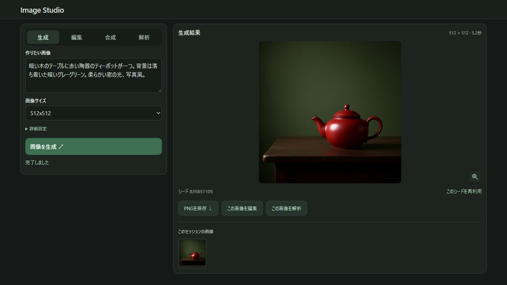
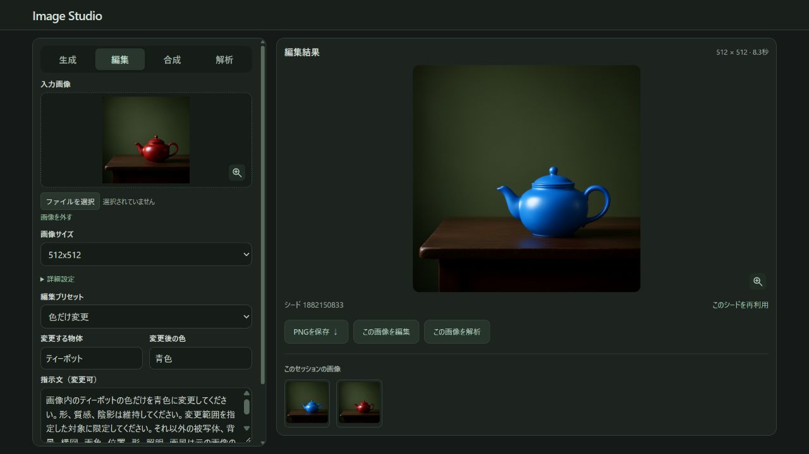

# Image Studio

NVIDIA DGX Spark向けの画像AIサービスです。画像の生成・編集・2画像合成・解析を、日本語WebUIとHTTP APIから利用できます。WebUIは落ち着いたダーク配色で、スマートフォンにも対応します。

生成・解析・API・WebUIは1つのコンテナで動作します。起動・停止・更新・ログ確認はこの1つに対して行います。

モデル本体は同梱しません。利用者が配布元から取得し、依存パッケージの導入・ビルド・実行はすべてコンテナ内で行います。

## スクリーンショット

文章から画像を生成し、結果のシードを再利用できます。



編集プリセットで対象と変更内容を指定できます。下の例はティーポットの色を赤から青へ変更しています。



## 動作条件

DGX Spark（GB10・共有メモリ128GB）での利用を前提としています。Linux ARM64、CUDA 13、Compute Capability 12.1（SM 121a）に固定したGPUレシピです。Docker ComposeとNVIDIA Container Toolkitが利用できる環境が必要です。

Macや他のGPU向けの構成は含みません。DGX Spark以外での動作は保証していません。

モデルの合計容量は約17.3GBです。CUDAのビルドキャッシュも含めたディスク容量と、生成・解析モデルを同時に保持できるGPUメモリ／共有メモリを確保してください。依存パッケージのインストールとモデルの実行はコンテナ内で行います。

## 起動

リポジトリのルートで実行します。

```sh
mkdir -p models output/telemetry
printf 'HOST_UID=%s\nHOST_GID=%s\nAPI_PORT=8000\nWEBUI_PORT=8080\n' "$(id -u)" "$(id -g)" > .env
```

`.env.example` は設定例です。`.env` はGitの対象外です。

モデルのライセンスを確認したうえで、利用者自身が配布元から取得します。固定リビジョン・容量・SHA256は `config/models.json` に記録しています。

```sh
docker compose build
MODEL_MOUNT_MODE=rw docker compose run --rm --no-deps --entrypoint python image-studio /app/tools/prepare_models.py --manifest /app/config/models.json
docker compose up -d --no-build
docker compose ps
```

| 用途 | DGX Spark上からの接続先 |
|---|---|
| WebUI | `http://localhost:8080` |
| API（OpenAI互換のbase_url） | `http://localhost:8000/v1` |

別端末から開く場合は、`localhost` をDGX Sparkのホスト名またはIPアドレスに置き換えてください。ポートを変更した場合は、`.env` の `WEBUI_PORT`・`API_PORT` に合わせます。

現在のAPIは認証トークンなしで利用できます。

## 運用と開発

```sh
docker compose logs -f
docker compose stop
docker compose up -d --build
```

1つのイメージ内で生成バックエンド、解析バックエンド、API、WebUIを起動します。8001・8002はコンテナ内のループバックだけで待ち受け、外部へ公開するのは従来どおりAPIの8000とWebUIの8080です。モデル・出力・ポート設定は引き継げます。

起動時にはモデルの容量とSHA256を確認し、共通ファイルの重複チェックを省略します。モデル読み込み中もWebUIを表示でき、全サービスの準備が整うとコンテナがhealthyになります。いずれかのプロセスが終了すると残りも停止し、Composeの再起動方針に従います。停止時も全プロセスへ終了シグナルを送り、終了しない場合は強制終了します。

アプリのソースはイメージに含まれます。更新は `docker compose up -d --build` に統一し、CUDA・モデル・Pythonの依存ビルドはDockerのキャッシュを利用します。モデル本体と出力はバインドマウントに保存するため、コンテナ再作成後も保持されます。

旧4コンテナ構成から移行する場合は、旧構成のComposeファイルで一度 `docker compose down` してから、新構成で起動してください。モデルと出力のディレクトリはそのまま利用します。`down -v` やモデルの再取得は不要です。

### Python・OSパッケージの更新

CUDAのベースイメージとdigest、生成・解析バックエンドのコミットは固定しています。Pythonは3.15.2を公式ソースからSHA256検証付きでビルドし、アプリ専用環境に配置します。ホストのPython・OS・ドライバーは変更しません。

実行イメージのUbuntu 24.04パッケージには、同リリースで提供される更新を適用します。CUDA/NVIDIA関連パッケージはholdし、更新前後でバージョンが一致することをビルド中に検証します。記録は `/usr/local/share/image-studio/cuda-packages.lock` にあります。

Python依存の直接指定は `gateway/requirements.txt`、推移的な依存を含む検証済みの固定値は `gateway/requirements.lock.txt` です。通常の再ビルドでは固定値とビルドキャッシュを使います。依存の更新時は固定値を更新してテストしてください。

Ubuntuパッケージだけを再取得する場合は、CUDAのコンパイル層を再利用し、Python構築・実行環境の層を再実行できます。

```sh
docker buildx build --load --no-cache-filter python-build,runtime -t image-studio:v1 .
docker compose up -d --no-build
```

この操作でもベースイメージやCUDAの固定値は変更しません。更新前のイメージを別タグで保持し、APIの回帰テストとDGX実機での動作確認後に切り替えてください。

## 使い方

- **生成**：文章から画像を作成します。
- **編集**：画像1枚の指定部分を変更します。入力画像の縦横比から出力サイズを自動選択します。
- **合成**：画像1を基準に、画像2から服・色・物体・背景・画風などを参照します。
- **解析**：画像について質問し、テキストまたはJSONで回答を受け取ります。

編集プリセットを選び、必要な対象や変更内容を入力すると指示文が入ります。「文字を追加」では配置場所と文字列、「ポーズを変更」では対象と変更後の姿勢を指定できます。文章は直接修正できます。部分編集は文章による指定で、マスク・ブラシによる領域指定は未対応です。

合成の「服・装飾を置き換える」では、服全体・上着・トップス・ボトムス・ワンピース／つなぎ・靴・帽子・アクセサリーから部位を選べます。画像2の対応する部位だけを参照し、それ以外の服や画像1の顔・姿勢を維持する指示文が入ります。文章は直接修正できます。部位の指定は文章によるもので、指定範囲以外の維持を保証するマスク処理ではありません。

合成の姿勢プリセットは「腕のみ合わせる」「脚のみ合わせる」「体の向きのみ合わせる」「頭の向きのみ合わせる」と「ポーズ全体を合わせる」を選べます。画像2から選んだパーツの姿勢だけを既存の解析APIで読み取り、その説明と画像1だけを既存の編集APIへ送ります。画像2そのものは生成モデルに渡しません。頭の向きを変える場合も、顔立ち・髪型は画像1を保つよう指示します。指示文を変更した場合は、その内容も追加して送信します。

結果の「採用して次へ」で、その画像を新しい画像1にして別のパーツを編集できます。画像2はそのまま保持されます。「採用を取り消す」で画像1を採用前へ戻せます（最大10段階）。取り消しても生成結果は通常の履歴に残ります（直近6枚）。入力画像1を選び直すと採用の取り消し履歴はリセットされます。これらの履歴はページを閉じるか再読み込みすると消えます。

文章による姿勢指定のため、対象外の部分の変化や姿勢のずれが残ることがあります。繰り返し編集すると顔や服の変化が蓄積する場合もあり、顔の完全な保持や姿勢の厳密な一致を保証するものではありません。

入力画像や生成・編集・合成の結果画像をクリックすると拡大表示できます。合成の画像1・2や、履歴から選び直した結果も確認できます。閉じるボタン・Escキー・画像の外側のクリックで元の画面に戻れます。

通常はランダムで生成し、結果に実際のシードを表示します。「このシードを再利用」で次の処理へ指定でき、詳細設定で手動入力やランダムへの復帰もできます。再現には入力画像・指示・サイズなども同じ条件にする必要があります。

入力画像はPNG・JPEG・静止WebPに対応しています（各16MiBまで）。WebPはAPI内で透過情報を保ってPNGに変換します。PNG変換後も16MiB以下が必要です。アニメーションWebPには対応していません。

入力画像と履歴は処理中も表示します。結果欄は待機エフェクトに切り替わり、完了後に新しい結果を表示します。履歴はブラウザ内に6枚まで保持され、ページを閉じるか再読み込みすると消えます。保存したい画像はPNGをダウンロードしてください。

## API

既存のモデルIDは互換性のため維持しています。生成・編集・合成は `qwen-image-2.1-turbo`、解析は `qwen-image-analysis` です。これは対応モデルを示す識別子で、製品名ではありません。

| 用途 | エンドポイント |
|---|---|
| 稼働状態 | GET `/health` |
| モデル一覧 | GET `/v1/models` |
| 生成 | POST `/v1/images/generations` |
| 1枚編集 | POST `/v1/images/edits` |
| 2画像合成 | POST `/v1/images/compositions` |
| 簡易解析 | POST `/v1/images/analyze` |
| OpenAI互換解析 | POST `/v1/chat/completions` |

要求・応答の例は [docs/API.md](docs/API.md) を参照してください。

同時推論は全体で1件です。実行中の追加要求には429を返します。画像入力は各16MiB、要求全体は32MiBまでです。生成条件は8ステップ・Euler・CFG=1・Turbo用sigma固定、エンコーダーと解析モデルはQ8_0です。

## 構成

```text
compose.yaml       コンテナ構成
gateway/           統合API
webui/             WebUIとAPI中継
Dockerfile         生成・解析のビルドと統合イメージ
runtime/           全プロセスの起動・終了管理とメモリ観測
config/            モデル取得・検証設定（重みは含まない）
tools/             モデル取得
tests/             個別環境に依存しないテスト
docs/              APIの利用方法
models/            利用者が取得するモデル（Git対象外）
output/            実行時データ（Git対象外）
```

## 常駐とキャッシュ

モデルは常駐させ、入力を再利用するための追加キャッシュは無効にしています。生成側は `--conditioning-cache-size 0`、解析側は `--cache-ram 0 --ctx-checkpoints 0 --no-cache-idle-slots` です。これらの追加キャッシュを使った再計算の省略は行いません。モデルの自動アンロードは行いません。

この設定は「モデル以外の全メモリを毎回解放する」ものではありません。解析のKVバッファや実行用バッファなど、バックエンドが常駐コンテキストに確保する領域は残ります。コンテキスト長8192・モデルの量子化・生成ステップ数は変更していません。

`output/telemetry` のGPU使用量は生成・解析プロセス別に計測します。`cgroup_memory_bytes` は両ファイルとも統合コンテナ全体の値です。生成・解析それぞれのRAM使用量として足し合わせないでください。

## 検証

API・WebUIのテストはモデルをロードせず、コンテナ内で実行できます。

```sh
docker compose run --rm --no-deps -e PYTHONPATH=/app/gateway:/app/webui:/app -v "$PWD/tests:/tests:ro" --entrypoint python image-studio -B -m unittest discover -s /tests -p "test_*.py"
```

PNGメタデータのテストはNode.jsの標準機能のみを使います。

```sh
node --test tests/test_png_seed.mjs
```

## ライセンス

自作のAPI・WebUI・レシピは [MIT License](LICENSE) です。依存ソフト、CUDAイメージ、モデルのライセンスは別です。[THIRD_PARTY_NOTICES.md](THIRD_PARTY_NOTICES.md) を参照してください。

生成モデルはQwen Research Licenseで、研究・評価目的の非商用利用に限定されています。商用利用には配布元との別契約が必要です。モデルの重みはこのリポジトリで再配布しません。モデル取得・利用は利用者自身が各配布元の条件に従って行ってください。

Image Studioは独立したプロジェクトで、NVIDIAやモデル提供元の公式製品ではありません。DGX Sparkの名称は対応ハードウェアを説明するために使用しています。
